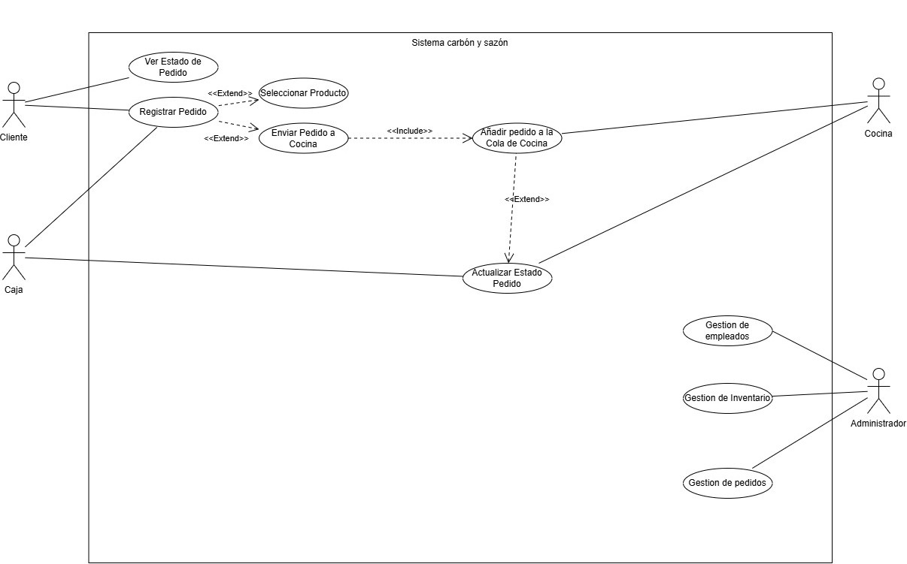
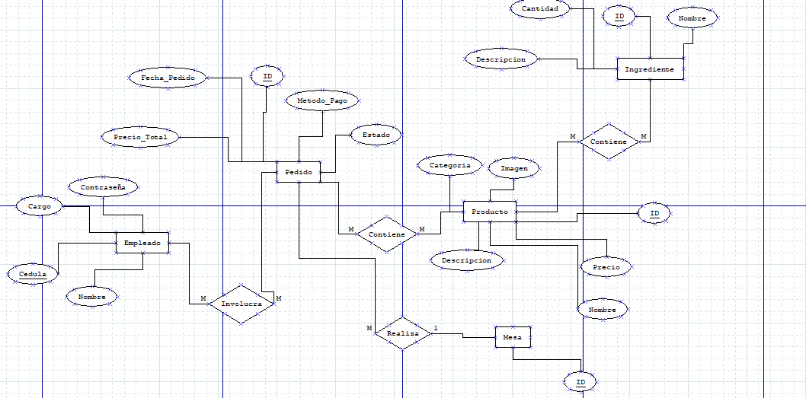
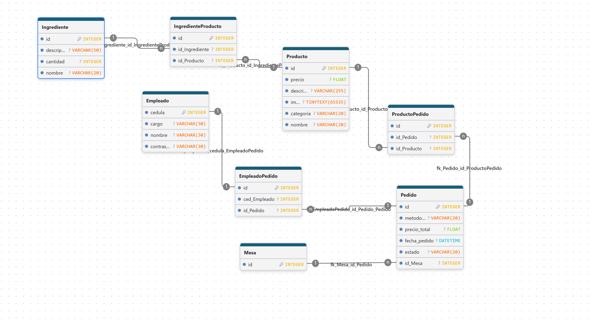
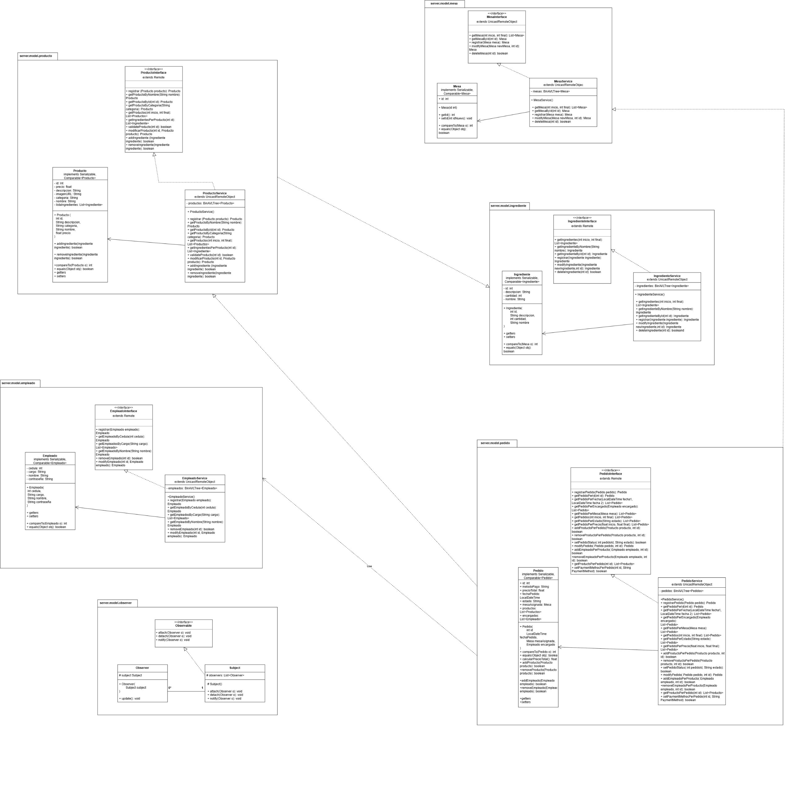

# Carbón y Sazón

Restaurant management system. Customers order from their phones, the cashier registers orders, the kitchen prepares
them and an administrator manages employees, inventory and orders. The interface is in Spanish.

## How it works

A central **server** owns the database and exposes its services through **Java RMI**. Every other app is a client of it.

```text
Phone browser ──HTTP──> Web API ──RMI──> Server ──JDBC──> PostgreSQL
                  Cashier / Kitchen / TV ──RMI──┘
```

| Module     | Folder               | Description                                                  |
| ---------- | -------------------- | ------------------------------------------------------------ |
| Server     | `ServerRestaurante/` | JavaFX admin app (employees, tables, ingredients, products, orders) + RMI server |
| Web client | `WebClient/`         | Spring Boot API + customer web page (order and track status from a phone) |
| Staff apps | `javaclient/`        | JavaFX apps for **Cashier**, **Kitchen** and **TV** (ready orders) |

**Stack:** Java, JavaFX, Spring Boot, Java RMI, PostgreSQL, Maven, JavaScript (Web Components).

## Diagrams

### Use cases



### Entity-relationship



### Relational model



### Classes



## Order statuses

`PENDIENTE` → `EN_COLA` → `PREPARANDOSE` → `PREPARADO` → `ENTREGADO` (or `CANCELADO`).
Orders made from the web start as `PENDIENTE`; staff move them to `EN_COLA`. Stock is discounted from `EN_COLA` onward.

## Getting started

**Requirements:** JDK 26, Maven 3.9+ and a PostgreSQL database.

**1. Server**

```bash
cd ServerRestaurante
cp config.properties.example config.properties   # fill in your IP and database
mvn clean install -DskipTests
java -jar target/ServerRestaurantProject.jar     # sign in, then start the server from the header switch
```

**2. Web client**

```bash
cd WebClient/backend
mvn clean package
java -jar target/api-1.0.0.jar    # sign in as an Administrador, then press "Iniciar vista móvil"
```

Set `rmi.host` in `WebClient/backend/src/main/resources/application.properties` to the server IP. The console prints
the URL to open from a phone (same Wi-Fi).

**3. Staff apps**

```bash
cd javaclient
mvn clean package
java -jar target/javaclient-1.4-caja.jar      # or -cocina.jar / -tv.jar
```

Set the server address in `javaclient/src/main/resources/client.properties`.

## Developers

- Camilo Andrés Serrano Jimenez ([@camilio77](https://github.com/camilio77))
- David Santiago Peña ([@Davidasuva](https://github.com/Davidasuva))
- Adrián Felipe Forero ([@fsadriann](https://github.com/fsadriann))
- Julián Benito ([@BunkerKing](https://github.com/BunkerKing))
- Juan Sebastián Rueda ([@juanse1172](https://github.com/juanse1172))
- Diego Alejandro Ayala ([@Diegoxs96](https://github.com/Diegoxs96))